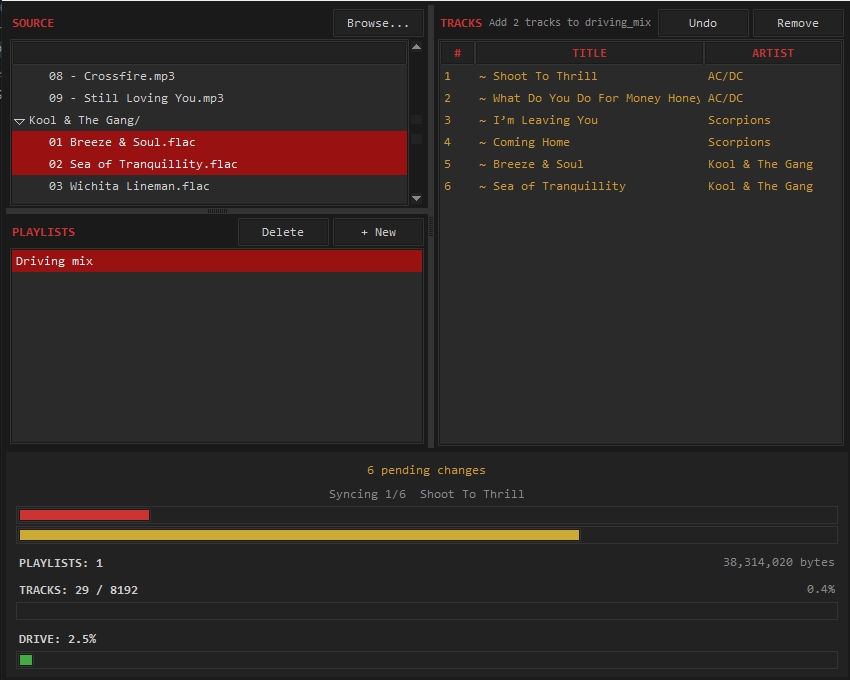
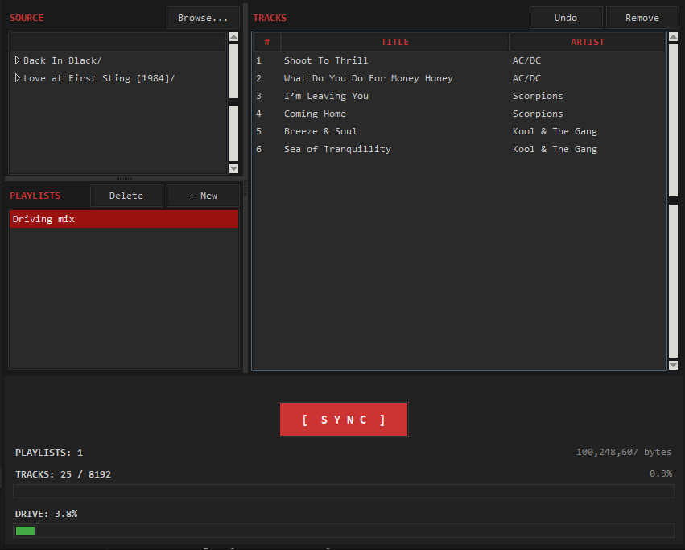
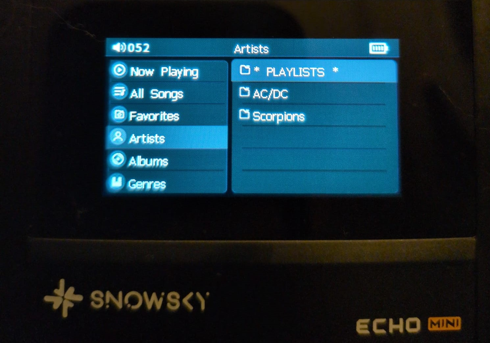
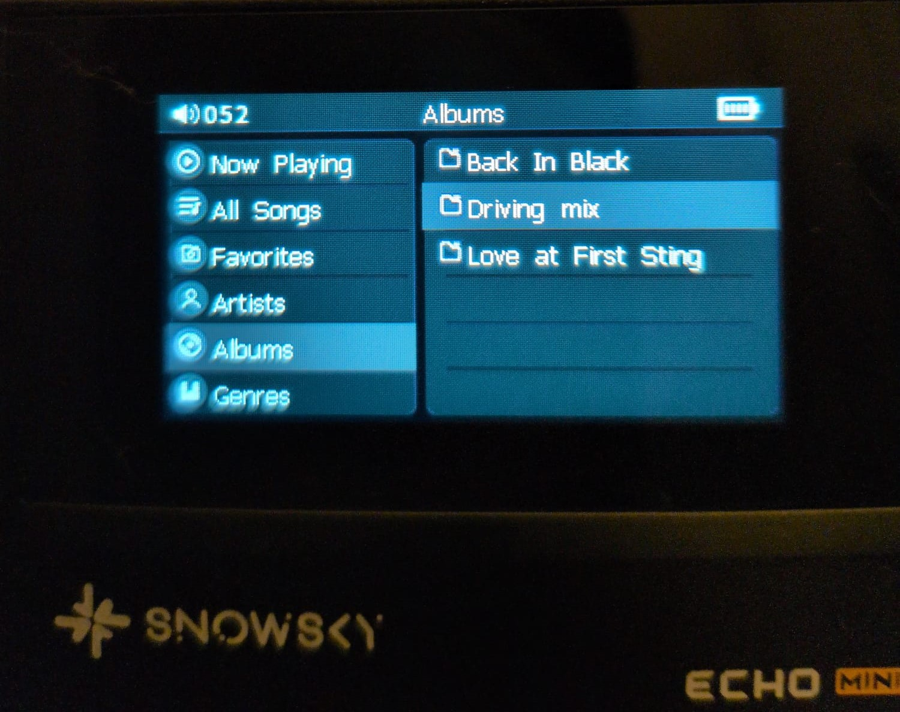

# EchoList

> Playlist manager for the SnowSky Echo Mini and portable music players.

The Echo Mini doesn't support `.m3u` playlists — its SoC simply ignores them. EchoList gives you real playlists by organizing tagged copies of your tracks into folders the device understands.

Songs can belong to multiple playlists. Your original library is never touched.

[](https://www.gnu.org/licenses/gpl-3.0)

---

## Download

**[Latest release (v0.2.0)](https://github.com/purpleturtle21/echo-list/releases/latest)** — Windows, Linux, macOS

| Platform | File | Notes |
|----------|------|-------|
| **Windows** | `echolist-windows.exe` | SmartScreen may warn — click "More info" → "Run anyway" |
| **Linux** | `echolist-linux` | `chmod +x echolist-linux && ./echolist-linux` |
| **macOS** | `echolist-macos-arm64` | Apple Silicon only, unsigned — see [macOS instructions](#macos) |

---

## How It Works

1. Point EchoList at your music library (source) and your device (destination)
2. Create playlists, drag in tracks, reorder as you like
3. Press **Sync**

EchoList copies the tracks to the device with proper metadata so they appear as playlists in the player's album/artist browser:

```
Artists                          Albums
├── AC/DC                        ├── Back In Black
├── Scorpions                    ├── Love at First Sting
├── Daft Punk                    ├── Discovery
│                                │
└── * PLAYLISTS *                ├── Driving
    ├── Driving                  ├── Party
    ├── Party                    └── Gym
    └── Gym
```

---

## Screenshots









---

## Features

- **Playlists** — create, rename, delete, reorder tracks via drag-and-drop
- **Multi-membership** — a song can be in multiple playlists at once
- **Import .m3u** — bring playlists from MusicBee, foobar2000, or any player that exports .m3u
- **Adopt folders** — already have music on the device? Right-click → adopt and EchoList manages it
- **Offload / Onload** — remove playlists from device to save space, bring them back later
- **Metadata fix** — audit and repair tags with one click
- **Automatic backups** — restore points saved every N syncs, manual restore anytime
- **Source search** — filter your library inline to find tracks fast
- **Undo** — undo staged changes before syncing
- **Track context menu** — right-click a track to jump to its source file or see which playlists it's in
- **Cross-platform** — Windows, Linux, macOS (macOS may be unstable)

---

## Installation

### Windows

1. Download `echolist-windows.exe` from the [releases page](https://github.com/purpleturtle21/echo-list/releases/latest)
2. Double-click to run — no install needed
3. If SmartScreen warns you, click **More info** → **Run anyway**

### Linux

```bash
# Download
wget https://github.com/purpleturtle21/echo-list/releases/latest/download/echolist-linux

# Make executable
chmod +x echolist-linux

# Run
./echolist-linux
```

Requires a display server (X11 or Wayland with XWayland). If you get tkinter errors, install `python3-tk` for your distro.

### macOS

> macOS has not been tested. It may work but is not guaranteed. Apple Silicon only.

```bash
# Download
wget https://github.com/purpleturtle21/echo-list/releases/latest/download/echolist-macos-arm64

# Remove quarantine and make executable
xattr -cr echolist-macos-arm64
chmod +x echolist-macos-arm64

# Run
./echolist-macos-arm64
```

### From source

```bash
git clone https://github.com/purpleturtle21/echo-list.git
cd echo-list
pip install mutagen pillow
python -m echolist
```

---

## FAQ

**Does this work with other players besides the Echo Mini?**
It should work with any player that reads metadata from FLAC/MP3/M4A files and browses by album/artist. The track ordering fix (tracknumber metadata) is specifically tested on the Echo Mini.

**Will it modify my original music files?**
No. EchoList only writes to the destination folder. Your source library is read-only.

**What formats are supported?**
FLAC, MP3, M4A/MP4 (including AAC in an MP4 container), WAV and AIFF are tagged. WAV/AIFF tags are written as an ID3 chunk; whether the Echo Mini shows ID3 tags in WAV files is not yet confirmed on a device. OGG, WMA, DSF/DFF and raw ADTS `.aac` files are copied but not tagged, so they won't group under the playlist in the album/artist browser.

**Can I use this without an Echo Mini?**
Yes — you can point it at any folder. It's useful for organizing music on SD cards, USB sticks, or any portable player.

**What happens if I unplug the device mid-sync?**
EchoList has a sync journal. On next launch it detects the interrupted sync and picks up where it left off.
Each file is written to a temporary name, flushed (`fsync`), renamed into place, and then the folder is flushed where the system supports it, so a finished step stays finished. That orders the writes; it cannot make a FAT32 card safe to pull mid-write — FAT32 has no journal, and the card's own controller may still be caching. Always eject the device before unplugging it.

**Why are there `._` files on my card after using a Mac?**
macOS keeps file attributes on FAT32 in hidden `._<name>` files, which the Echo Mini lists as broken tracks. EchoList deletes the ones its own writes create. Files you copy with Finder still get them; `dot_clean -m /Volumes/<card>` removes them.

**I have playlists in MusicBee/foobar2000 — can I import them?**
Yes. Export as `.m3u` from your player, then File → Import .m3u in EchoList.

---

## Trade-offs

| | |
|---|---|
| **Extra storage** | Each playlist track is a physical copy on the device |
| **Shuffle-all bias** | Tracks in multiple playlists get shuffled more often |
| **Playlist-only tracks** | Won't appear under their artist when browsing by artist |

---

## Contributing

Bug reports, suggestions, and pull requests are welcome.

If you test EchoList on devices other than the Echo Mini, feel free to share your results.

---

## License

GNU General Public License v3.0 — see [LICENSE](LICENSE).
